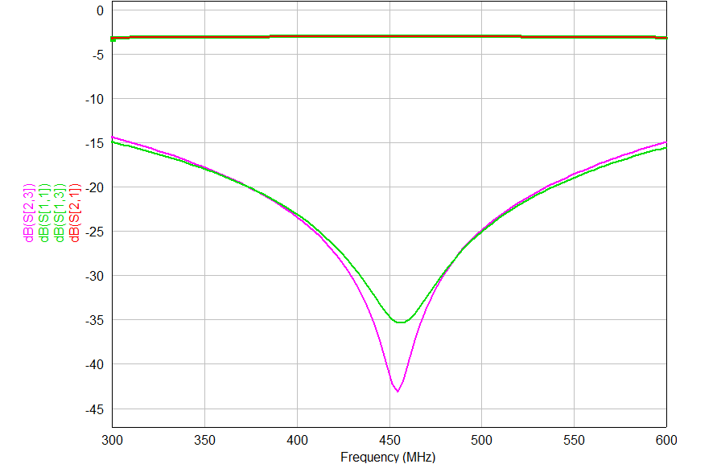
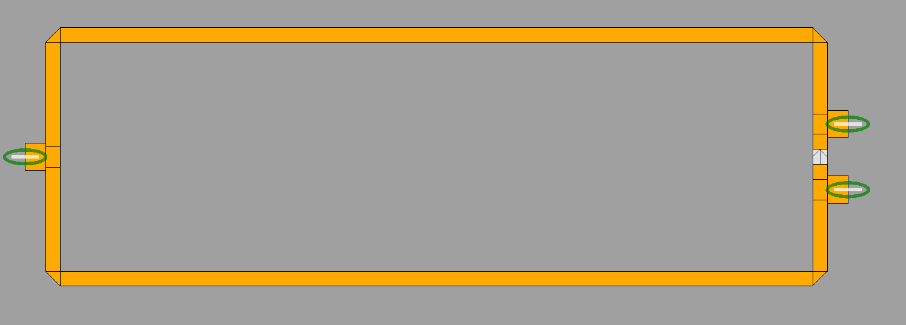
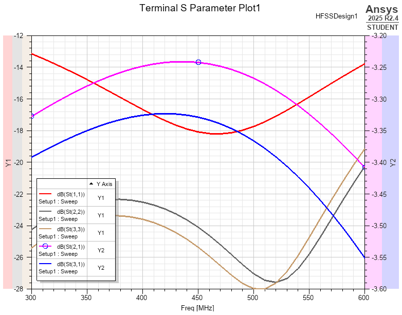
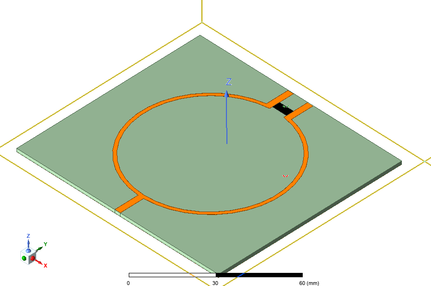

# UHF Wilkinson Power Divider 
A 100MHz bandwidth Wilkinson power devider with 450 MHz center frequency using FR-4 KB-6164 laminate. 

* 100MHz bandwidth 
* up to -40dB isolation between output gates
* good (-18dB) input 50-Ohm match for all gates 
* low-cost assembly using standart KB-6164 laminate

### JLCPCB optimization
Electrical omponents and dielectric material is chosen to be a standart low-cost assembley. Usuall KB-6164 FR4 laminate and two-sided 1oz copper plating needed for PCB production.  

### QUCS project
Microstrip schematic project created and simulated using QUSC studio v5.9

### HFSS simultaion
Round-shaped version of divider is simulated using Ansys HFSS   

 